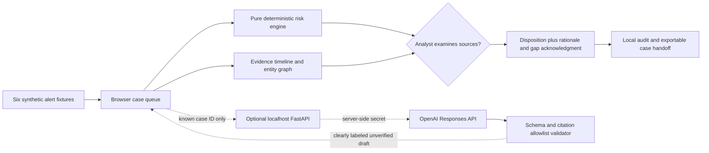

# EvidenceGraph architecture — runnable prototype

## Data flow

## Sources of truth

`data/scenarios.json` is the master fixture. `scripts/build_site.py` generates `js/scenarios.js` for offline hosting. Each event has an ID, timestamp, source, type and raw fields. Every `signal` must reference one or more actual event IDs; validation tests fail if an ID is invented. Signals have explicit author-assigned weights, `observed` or `inference` labels, and an explanation.

The rule-based training score is `min(100, 10 + sum(signal weights))`. Severity thresholds: High >= 75, Medium >= 45, else Low. **No probabilistic calibration exists.** Evidence coverage = available telemetry categories / expected categories, completely independent of severity. A missing stream is a *gap*, not proof an incident is benign.

## Boundaries

| Layer | Responsibility | Not implemented |
|---|---|---|
| Static browser | Filter, inspect, source-check, annotate, locally dispose, export | Accounts, shared cases, SIEM connectors |
| Core logic | Transparent rules, provenance validation, decision guardrails | Trained risk model, incident attribution |
| Optional API | Load a fixed training case, send minimized records to model, reject invalid citations | Public multi-user auth, ingestion, secure multi-tenant storage |
| Model adapter | Request `store: false` structured output; label content as unverified | Independent fact validation, prompt-injection immunity |

## Practical next architecture, not yet built

A future pilot should use read-only source adapters (e.g., Splunk saved searches, Sentinel incidents, GuardDuty/CloudTrail), a normalization layer (ECS/OCSF), data minimization, case DB with durable append-only decisions, OIDC with analyst/lead role separation, bounded curated knowledge retrieval and an evaluator. No remediation system should receive decisions automatically.

## Additional integration suggestions

1. Ingest a *single approved case* through a read-only SIEM API with least-privilege access and field-level redaction.
2. Convert all timestamps to UTC and normalize identity/asset keys. Preserve original event pointers or hashes.
3. Store claims with `source_ids`, extraction method, model/prompt version and uncertainty. Show missing data prominently.
4. Separate model evidence assessment from escalation policy; rules own policy, analysts own disposition.
5. Use the existing ticket platform (e.g., ServiceNow/Jira) only after explicit approval and RBAC; keep immutable audit and dual approval for closures.
